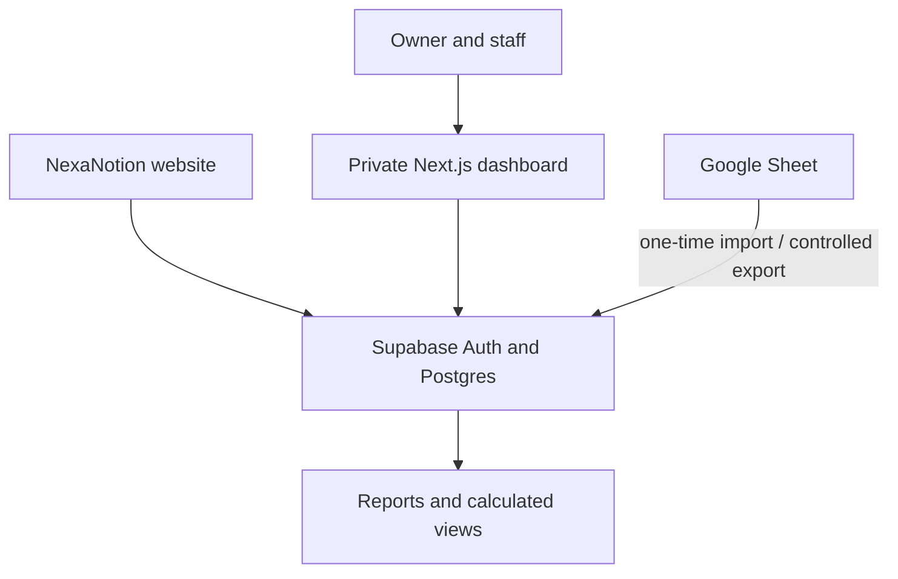

# NexaNotion Business Dashboard — Development Plan

**Prepared:** 14 July 2026  
**Project:** NexaNotion Business Economics Tracker Web App  
**Recommended product shape:** Separate, private dashboard web application connected to NexaNotion's existing Supabase project  
**Primary users:** NexaNotion owner/admin and approved data-entry users  
**Currency and timezone:** BDT (৳), Asia/Dhaka

## 1. Product vision

Build a professional business-management web application that replaces manual spreadsheet entry with guided forms, protected calculations, live analytics, and mobile-friendly workflows.

The application will:

- accept manual data for Messenger, Facebook Page, WhatsApp, phone, and other offline orders;
- automatically include compatible orders from the live NexaNotion website;
- calculate revenue, COGS, courier costs, packaging, profit, advertising performance, inventory value, and cash movement;
- provide visual dashboards, filters, charts, reports, warnings, and reconciliation checks;
- keep Order Status and Settlement Status separate while warning about inconsistent combinations;
- protect formulas and business rules by moving them from editable spreadsheet cells into tested server-side database logic;
- preserve the current Google Sheet as an import/export and backup surface after migration.

This is an internal business application, not a customer-facing part of the public store.

## 2. Recommended architecture

### Application stack

| Layer | Recommended technology | Purpose |
| --- | --- | --- |
| Web app | Next.js App Router + TypeScript | Application shell, server rendering, routes and server-side actions |
| UI | Tailwind CSS + shadcn/ui | Clean, consistent, accessible interface |
| Forms | React Hook Form + Zod | Guided input, validation and clear error handling |
| Tables | TanStack Table or equivalent | Search, filters, sorting, pagination and column visibility |
| Charts | Recharts | Colourful responsive business charts |
| Database | Existing Supabase Postgres | One source of truth for operational and financial records |
| Authentication | Supabase Auth | Private owner/admin access |
| Storage | Supabase Storage, if receipts are added | Optional receipt and evidence uploads |
| Hosting | Vercel | Preview deployments and production hosting |
| Testing | Vitest + Playwright | Calculation, integration and browser workflow verification |

### Repository and deployment shape

- Create a separate repository named `nexanotion-business-dashboard`.
- Deploy it as a separate Vercel project.
- Connect it to the existing NexaNotion Supabase project after a schema compatibility audit.
- Use a private subdomain such as `dashboard.nexanotion.online` or `business.nexanotion.online`.
- Reuse existing `products`, `orders`, `order_items`, and admin authentication only when the live schema is compatible.
- Add new tables through versioned, reversible migrations. Do not edit production tables manually without a migration.

## 3. Source-of-truth policy

After production cutover:

1. Supabase becomes the authoritative data source.
2. The app becomes the normal place to add and update records.
3. The Google Sheet becomes a read-only archive, controlled export, or emergency backup.
4. The same records must not be edited independently in both the app and the sheet.

Bidirectional Google Sheets synchronisation is intentionally excluded from the first release because it creates duplicate-record and conflict risks. A controlled export can be added later.

## 4. Information architecture

### Primary navigation

1. **Dashboard** — KPIs, charts, warnings and recent activity.
2. **Orders** — order list, new order, status updates and order detail.
3. **Products** — catalogue cost, selling price, stock and profitability.
4. **Marketing** — campaigns and daily advertising spend.
5. **Expenses** — operating expense entry and analysis.
6. **Cash & Settlements** — cash inflow/outflow, courier settlement and owner investment.
7. **Reports** — monthly summary, product performance and exports.
8. **Data Checks** — reconciliation failures, missing links and duplicates.
9. **Settings** — courier costs, packaging, currency, lookup options and users.

### Global application shell

- Dark deep-navy sidebar on desktop.
- Compact top bar with page title, global search, date filter, notifications and account menu.
- Collapsible sidebar for smaller laptops.
- Mobile drawer or bottom navigation for the highest-frequency destinations.
- Persistent **Add New** action with context-aware choices: Order, Product, Expense, Ad Spend, Campaign or Cash Transaction.
- Breadcrumbs on detail and edit pages.
- Unsaved-change warning on forms.

## 5. Frontend UI and visual direction

### Visual identity

- Primary: NexaNotion deep navy.
- Secondary: royal blue and cyan.
- Positive: emerald green.
- Warning: amber.
- Negative: coral/red.
- Accent: restrained violet gradient for selected highlights.
- Canvas: soft off-white/light grey with white content cards.
- Typography: Geist or Inter, with tabular numerals for financial values.

Colour will communicate meaning, not decorate every surface. KPI cards and charts may use multiple colours, while forms and tables remain calm and readable.

### Responsive layout

| Screen | Behaviour |
| --- | --- |
| Desktop | Sidebar, 4-column KPI grid, wide tables, multi-chart dashboard |
| Tablet | Collapsible navigation, 2-column cards, horizontally scrollable tables |
| Mobile | Single-column cards, filter sheet, compact record cards, sticky save/add controls |

### Core UX states

Every module must include:

- loading skeletons;
- empty states with the correct next action;
- field-level validation messages;
- retryable error states;
- success confirmation and toast messages;
- clear delete/archive confirmation;
- accessible focus states and keyboard navigation;
- tooltips for accounting terms such as COGS, ROAS and CAC.

## 6. Dashboard UX specification

### Global filters

- Start and end date.
- Presets: Today, Last 7 Days, This Month, Last Month, Custom.
- Sales channel.
- Order status.
- Campaign.
- Product category.

Filters must be reflected in the URL so a view can be bookmarked and refreshed without losing state.

### KPI cards

- Total Orders.
- Delivered Orders.
- Pending/Active Orders.
- Product Revenue.
- Net Revenue.
- COGS.
- Gross Profit.
- Net Profit.
- Profit Margin.
- Advertising Spend.
- Average Order Value.
- COD/Courier Receivable.
- Current Cash Balance.
- Inventory Value.

Each card should display the current value, comparison with the previous matching period, and a tooltip explaining the formula.

### Charts and visual reports

- Revenue, gross profit and net profit trend.
- Order-status distribution.
- Revenue versus advertising spend.
- Campaign ROAS and CAC comparison.
- Top products by delivered units.
- Top products by gross profit.
- Expense breakdown by category.
- Cash inflow versus outflow.
- Monthly performance comparison.

### Action and warning panels

- Low-stock products.
- Settled orders not marked Delivered.
- Delivered orders without order items.
- Duplicate order numbers.
- Unknown SKU/order links.
- Campaigns with spend but no delivered orders.
- Recent orders and recent cash transactions.

## 7. Input workflows and automatic calculations

### 7.1 New order workflow

Use one guided multi-section form instead of separate spreadsheet rows.

#### Manual inputs

- Order date.
- Order number or external reference.
- Sales channel.
- Customer location.
- Courier.
- Order Status.
- Payment Method.
- Settlement Status.
- Campaign, if applicable.
- Discount.
- Delivery amount charged to customer.
- Refund amount, when applicable.
- One or more product items:
  - product/SKU;
  - quantity;
  - actual unit selling price.

#### Automatic behaviour

- Selecting an SKU fills product name, list price and current unit buying cost.
- Quantity × actual price calculates line revenue.
- Quantity × cost snapshot calculates line COGS.
- Order product revenue is the sum of line revenue.
- Order total = product revenue + delivery charged − discount.
- Courier cost uses the current inside/outside-Dhaka rule when the order reaches a courier-cost-bearing status.
- Packaging cost uses the configured default.
- Historical price and cost snapshots are stored on the order item so old profit does not change when product prices change later.
- Recognized revenue and COGS activate only when Order Status is Delivered.
- Net revenue is adjusted for refund amount.
- Gross profit and contribution profit update instantly in the form summary.

#### Guardrails

- Reject duplicate order numbers.
- Require at least one item before Delivered can be saved.
- Warn if Settled is selected while Order Status is not Delivered.
- Warn when Delivered is selected but Settlement Status remains Awaiting.
- Warn when actual selling price is below unit cost.
- Reject negative amounts and zero/negative quantity.
- Reject refund greater than the allowed order value unless an administrator explicitly confirms an exception.

Creating the order and all its items must be one atomic database operation: either everything saves or nothing saves.

### 7.2 Products

#### Manual inputs

- SKU.
- Product name.
- Category.
- Colour/variation.
- Buying price.
- Regular selling price.
- Current stock.
- Reorder level.
- Active/archived status.

#### Automatic outputs

- Unit gross profit.
- Gross margin percentage.
- Inventory value.
- Low-stock status.
- Delivered units, revenue, COGS and gross profit.
- Product ranking.

Existing live store products should be reused instead of duplicated. Tracker-only cost and reorder fields can be added through a safe migration or companion inventory table after schema inspection.

### 7.3 Campaigns

#### Manual inputs

- Campaign name.
- Platform.
- Start/end date.
- Product/category.
- Target audience.
- Planned budget.
- Messages/leads when entered manually.

#### Automatic outputs

- Actual spend from daily spend entries.
- Orders received.
- Delivered orders.
- Attributed revenue.
- Cost per message.
- Cost per order.
- Delivered CAC.
- ROAS.
- Budget utilisation.

### 7.4 Daily advertising spend

Manual fields: spend date, campaign, platform, product/category, amount and notes. The app should prevent accidental duplicate entries for the same campaign/date unless the user confirms there were multiple charges.

### 7.5 Expenses

Manual fields: expense date, generated expense ID, category, description, vendor/payee, amount, payment method, paid-from account, receipt/reference and notes.

Optional later enhancement: upload receipt images to private Supabase Storage.

### 7.6 Cash and settlements

Manual fields: transaction date, transaction ID, transaction type, account/method, reference order, description, inflow, outflow, settlement reference, notes and owner/person.

Automatic outputs:

- net movement;
- running balance;
- balance by cash account;
- owner investment summary;
- unsettled courier/COD receivable;
- reconciliation warnings.

Profit and cash balance must remain separate concepts throughout the UI.

### 7.7 Settings

- Currency: BDT.
- Timezone: Asia/Dhaka.
- Default courier: Steadfast.
- Inside Dhaka courier cost.
- Outside Dhaka courier cost.
- Packaging cost per order.
- Tax/VAT default.
- Allowed order statuses.
- Payment methods.
- Settlement statuses.
- Sales channels.
- Locations.

Settings that affect financial history should be copied into new records as snapshots; changing a default must not rewrite old orders.

## 8. Backend and data model

### Core tables

| Table | Purpose |
| --- | --- |
| `profiles` or existing admin profile table | User identity, role and active status |
| `business_settings` | Current default courier, packaging, currency and tax rules |
| `products` / compatible existing table | Product catalogue and stock |
| `orders` / compatible existing table | Order header, statuses, channel, campaign and financial snapshots |
| `order_items` / compatible existing table | Product lines with quantity, price and cost snapshots |
| `campaigns` | Campaign plan and audience information |
| `ad_spend_entries` | Daily advertising spend records |
| `expenses` | Operating expenses |
| `cash_accounts` | Cash, bKash, Nagad, bank and courier accounts |
| `cash_transactions` | Inflow, outflow, owner investments and settlements |
| `audit_logs` | Important record changes, user, time and before/after context |

### Data design rules

- Use UUID or existing stable primary keys internally.
- Keep user-visible order numbers as unique text, not numeric IDs.
- Use `numeric(12,2)` for money; never floating-point types.
- Use `date` for business dates and `timestamptz` for audit timestamps.
- Add database checks for non-negative money, positive quantity and allowed status values.
- Add indexes to every foreign key.
- Add composite indexes for frequent filters such as `(status, order_date)`, `(campaign_id, order_date)`, `(product_id, order_id)` and `(campaign_id, spend_date)`.
- Use soft archive/void behaviour for financial records instead of silent hard deletion.
- Store `created_by`, `updated_by`, `created_at`, and `updated_at` where appropriate.
- Never store calculated values twice unless a historical snapshot is required.

### Calculated database layer

Create SQL views or security-safe RPC functions for:

- order financials;
- dashboard metrics for a date range;
- product performance;
- campaign performance;
- monthly summary;
- cash balance by account;
- COD/courier receivable;
- data-quality checks.

The app should request aggregated results from the server rather than downloading thousands of rows and calculating everything in the browser.

### Atomic operations

A secured Postgres function or equivalent server transaction should create/update an order and its items together. External network calls must not be made while a database transaction is holding locks.

## 9. Authentication, permissions and security

### Initial roles

- **Owner:** full access, settings, exports and user management.
- **Admin:** full operational access without ownership-sensitive settings.
- **Data Entry:** create and edit operational records; limited delete/void permission.
- **Viewer:** dashboards and reports only.

The first release may launch with only the Owner account while keeping the schema role-ready.

### Security requirements

- Supabase Auth email/password login.
- Admin allowlist or approved profile record.
- Row-Level Security enabled on every private business table.
- Role checks enforced by database policy, not only hidden buttons.
- Service-role key used only on the server and never exposed to the browser.
- Secrets stored in local/Vercel environment settings, never committed to Git.
- Private receipts/storage bucket with signed access.
- Session expiry and logout controls.
- Audit trail for status, settlement, refund, expense and cash changes.
- Rate limits and validation on write endpoints.
- Production database backup before every migration/cutover.

## 10. Integration with the existing NexaNotion website

The dashboard should read website orders from the same Supabase project where safe. The implementation depends on the live schema audit.

Recommended model:

- Website orders keep their current checkout and order-number workflow.
- Manual orders use the dashboard but write to the compatible operational model.
- Every order records a `source` or sales channel.
- Analytics views combine website and manual orders.
- The public website never receives access to private cost, expense, campaign or cash tables.
- Existing website behaviour must remain unchanged unless an approved migration explicitly requires a narrow modification.

## 11. Google Sheet migration and reconciliation

### One-time migration

1. Back up the current spreadsheet.
2. Export or securely read Products, Orders, Order Items, Ad Campaigns, Daily Ad Spend, Expenses, Cash & Settlements and Setup.
3. Validate dates, currency, order numbers, SKUs and campaign links.
4. Import lookup/master data first.
5. Import products, then orders, then order items.
6. Import campaigns, ad spend, expenses and cash transactions.
7. Run reconciliation checks.
8. Compare app KPIs with the spreadsheet for the same reporting period.
9. Approve cutover and make the sheet read-only/archive.

### Required parity checks

- Order-item revenue equals order product revenue.
- Order-item COGS equals order product COGS.
- No unknown SKU.
- No unknown Order Number.
- No delivered order without items.
- No duplicate order number.
- Delivered count, revenue, COGS, gross profit, ad spend, expenses and cash balance match expected values.
- Financial comparisons tolerate only an agreed rounding difference, normally less than ৳0.01.

## 12. Testing and quality assurance

### Automated tests

- Unit tests for every financial formula and status rule.
- Database tests for constraints and RPC functions.
- RLS tests proving unauthorised users cannot read or write business data.
- Integration tests for order creation and updates.
- End-to-end tests for login, manual order, product, campaign, expense, cash transaction and dashboard filtering.
- Regression tests for the two distinct statuses: Delivered and Settled.

### Manual QA

- Desktop, tablet and mobile layouts.
- Keyboard navigation and focus visibility.
- Currency/date formatting.
- Empty, loading and error states.
- Very long product/campaign names.
- Multiple products in one order.
- Refund, return and failed-delivery scenarios.
- Low-stock and overselling behaviour.
- Production test order and settlement.

### Performance

- Server-side pagination for tables.
- Bounded, indexed filters.
- No N+1 product/order queries.
- Aggregated SQL for charts.
- Lazy-load heavy charts and secondary panels.
- Review query plans for dashboard and report queries before launch.

## 13. Delivery phases

### Phase 0 — Discovery, backup and decisions

**Scope**

- Inspect the existing NexaNotion repository, dependencies, Supabase schema, migrations, RLS and admin authentication.
- Back up the production database and current Google Sheet.
- Finalise terminology, KPI dictionary and source-of-truth rules.
- Confirm app name, subdomain, roles and MVP boundaries.

**Codex**

- Perform a read-only technical audit.
- Document schema compatibility and migration risks.
- Produce an implementation checklist and affected-file map.

**ChatGPT Work (me here)**

- Maintain the product plan and decisions log.
- Map tracker fields, rules and calculations.
- Turn business feedback into precise Codex tasks.

**You**

- Confirm the preferred subdomain and design direction.
- Confirm owner/admin email addresses.
- Back up or approve backup of production data.
- Confirm courier, packaging, tax and reporting rules.

**Exit criteria:** no unresolved critical schema, security or accounting decision.

### Phase 1 — UX prototype and frontend foundation

**Scope**

- Create the new repository and Next.js application.
- Implement the design system, app shell, responsive navigation and mock-data screens.
- Prototype Dashboard, Orders list, New Order and Product screens.

**Codex**

- Scaffold the application and component system.
- Implement responsive mock screens and accessibility basics.
- Add linting, type checking and test infrastructure.

**ChatGPT Work**

- Review screenshots and interaction flow.
- Refine labels, help text, error messages and dashboard hierarchy.
- Keep design decisions consistent with NexaNotion.

**You**

- Choose between presented visual options.
- Approve the information hierarchy and mobile workflow.

**Exit criteria:** approved responsive prototype with no production database writes.

### Phase 2 — Database, authentication and security foundation

**Scope**

- Add compatible tables/columns, constraints, indexes, RLS and audit structure.
- Configure Supabase SSR authentication and protected routes.
- Seed settings and allowed options.

**Codex**

- Write versioned migrations and rollback notes.
- Implement RLS policies and role checks.
- Add database and auth tests.

**ChatGPT Work**

- Review the field mapping and security checklist.
- Confirm that calculations match the tracker definition.

**You**

- Create/confirm the admin user.
- Add environment variables directly to local/Vercel settings.
- Never paste the service-role key into a normal chat or commit it to Git.

**Exit criteria:** authenticated owner can access; unauthorised users cannot access private data; migrations pass on a test environment.

### Phase 3 — Core order management

**Scope**

- Orders list, filters, detail page and guided create/edit form.
- Multi-item order entry and automatic calculations.
- Status/settlement warnings, refunds and audit history.
- Atomic order + order-items save.

**Codex**

- Implement backend transactions, form validation and UI.
- Add calculation and workflow tests.
- Prevent duplicates and invalid status transitions.

**ChatGPT Work**

- Create real-world test scenarios from current NexaNotion orders.
- Review the form for clarity and unnecessary steps.
- Verify displayed calculations against tracker results.

**You**

- Enter several test orders, including multi-product, Delivered, Pending and refund cases.
- Confirm that the workflow matches how you actually process Messenger orders.

**Exit criteria:** test orders save correctly, calculations reconcile and all data-quality checks pass.

### Phase 4 — Products, marketing, expenses and cash modules

**Scope**

- Product cost/stock management.
- Campaign and daily ad-spend entry.
- Expense entry and categorisation.
- Cash accounts, owner investment and settlements.
- Settings management.

**Codex**

- Build all CRUD screens and server actions.
- Add validation, pagination, filters and audit history.
- Implement automatic performance and cash calculations.

**ChatGPT Work**

- Review forms, option lists and business terminology.
- Identify missing operational fields from real usage.

**You**

- Confirm expense categories, cash accounts, owner names and allowed option lists.
- Test each entry form with real or clearly marked test records.

**Exit criteria:** every current spreadsheet manual-input area has a safe app equivalent.

### Phase 5 — Dashboard, charts and reports

**Scope**

- KPI cards, date filters, charts, product performance, campaign performance and monthly reports.
- Data Checks and warning centre.
- CSV/Excel export.

**Codex**

- Implement server-side aggregate queries/views.
- Build responsive charts and report tables.
- Add filter persistence and previous-period comparisons.

**ChatGPT Work**

- Review whether each visual answers a useful business question.
- Simplify crowded screens and clarify financial explanations.

**You**

- Approve the default KPI order and chart priority.
- Confirm which report you use most often on mobile.

**Exit criteria:** dashboard metrics match the same source records and filters; visual QA passes on desktop and mobile.

### Phase 6 — Migration and live website integration

**Scope**

- Import existing spreadsheet records.
- Connect compatible website orders/products.
- Reconcile all historical and current totals.
- Establish archive/export workflow.

**Codex**

- Build a repeatable import script with dry-run mode.
- Produce migration logs, rejected-row report and reconciliation output.
- Add an adapter/view if the existing store schema differs.

**ChatGPT Work**

- Compare migrated app totals with the live sheet.
- Track discrepancies and confirm their business meaning.

**You**

- Provide/approve the spreadsheet export or secure Google access method.
- Resolve ambiguous records that only the business owner can identify.
- Approve the final cutover totals.

**Exit criteria:** required checks pass and the app matches the approved tracker baseline.

### Phase 7 — Security, QA and production hardening

**Scope**

- Full test suite, RLS verification, accessibility, performance, error handling and backup/restore checks.
- Mobile/desktop browser QA.
- Production-readiness documentation.

**Codex**

- Run lint, typecheck, unit, integration, E2E and production build.
- Fix regressions and review queries/indexes.
- Check secrets, logs and error boundaries.

**ChatGPT Work**

- Coordinate acceptance testing and review screenshots/results.
- Maintain the launch-blocker checklist.

**You**

- Perform owner acceptance testing with real workflows.
- Confirm access from your phone and computer.

**Exit criteria:** no critical/high launch blockers; all financial and access-control tests pass.

### Phase 8 — Deployment, cutover and handover

**Scope**

- Connect GitHub and Vercel.
- Configure the production domain and secrets.
- Deploy, verify and restrict access.
- Complete one production test order and settlement.
- Deliver operating instructions.

**Codex**

- Prepare deployment configuration, environment example and runbook.
- Deploy or guide deployment within approved access.
- Verify production routes and logs.

**ChatGPT Work**

- Guide each manual dashboard/Vercel/Namecheap step.
- Prepare the user guide and post-launch checklist.

**You**

- Connect the GitHub/Vercel accounts if required.
- Add secret environment values directly in Vercel.
- Add/approve the DNS record for the chosen subdomain.
- Approve production access and complete the final real test.

**Exit criteria:** private production app is live, verified, documented and ready for daily use.

### Phase 9 — Optional automation and advanced features

Only after the MVP is stable:

- Meta Ads API spend import.
- Courier/Steadfast status and settlement integration.
- Low-stock and settlement notifications.
- Receipt uploads and OCR.
- Scheduled PDF/monthly email report.
- Multiple staff roles and approval workflow.
- Forecasting, target tracking and AI-assisted business insights.

## 14. Responsibility summary

### Codex will

- work directly in the repository;
- scaffold and implement the frontend and backend;
- write Supabase migrations, RLS policies, APIs/RPCs and calculation views;
- create forms, tables, charts and responsive UI;
- write tests, run builds, debug errors and review performance;
- create import scripts and deployment configuration;
- document changed files, migrations, validation results and remaining risks.

### ChatGPT Work (me in this project thread) will

- act as product strategist, business analyst and project coordinator;
- keep the tracker, requirements, decisions and phase status aligned;
- turn your business requests into precise Codex prompts/tasks;
- review UI screenshots, calculations, test output and deployment steps;
- explain unfamiliar tools and guide manual actions step by step;
- help prepare data, copy, reports, training materials and launch checklists.

### You will manually

- make business decisions and approve the design;
- choose the final subdomain and app access policy;
- confirm financial rules, owners, expense categories and lookup options;
- create/confirm accounts and grant only necessary access;
- add secrets to Supabase/Vercel settings without sharing them publicly;
- connect GitHub/Vercel and edit Namecheap DNS when required;
- identify ambiguous historical records;
- test the app with real workflows and approve production cutover.

You will not need to write application code.

## 15. MVP boundary

### Included in the first production release

- Private login.
- Manual operational input.
- Website/manual order reporting.
- Automatic calculations.
- Products and inventory basics.
- Campaigns and daily spend.
- Expenses and cash transactions.
- Responsive dashboard and reports.
- Data-quality checks.
- Spreadsheet migration.
- CSV/Excel exports.

### Deferred until after launch

- Direct Meta Ads API automation.
- Courier API automation.
- Bank, bKash or Nagad automatic feeds.
- Public customer accounts.
- Multi-business/multi-tenant support.
- Formal accounting/tax filing.
- AI forecasting or automated financial advice.

## 16. Decisions required before Phase 1

Recommended defaults are shown in bold.

1. App placement: **separate private application**.
2. Repository: **new `nexanotion-business-dashboard` repository**.
3. Database: **existing NexaNotion Supabase project after audit**.
4. Source of truth after migration: **Supabase/app**.
5. Google Sheet after migration: **read-only archive/export**.
6. Initial roles: **Owner only, role-ready for future staff**.
7. Default UI: **light workspace with deep-navy navigation and colourful semantic charts**.
8. Suggested domain: **dashboard.nexanotion.online**.

## 17. Definition of production-ready

The app is complete only when:

- all MVP screens and forms work on desktop and mobile;
- RLS and private access are verified;
- all calculation and reconciliation tests pass;
- spreadsheet data is migrated and approved;
- a real production order completes the full order-to-settlement workflow;
- dashboard totals match the source records;
- secrets are correctly configured and absent from Git;
- production backup, migration and recovery notes exist;
- the owner has a short operating guide and can complete daily tasks without editing database tables or formulas.

